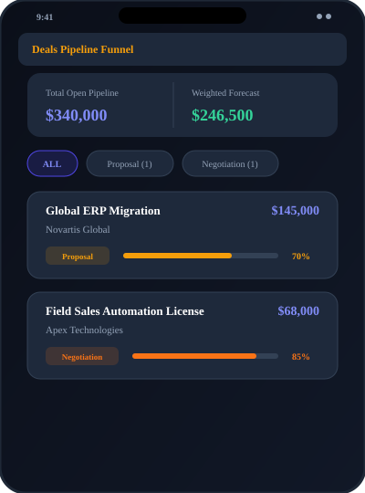
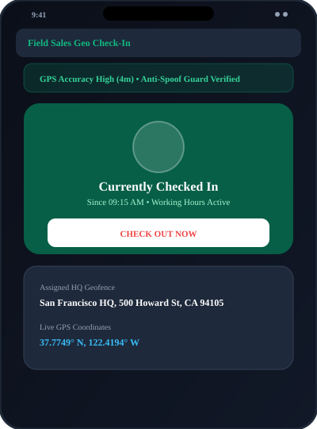
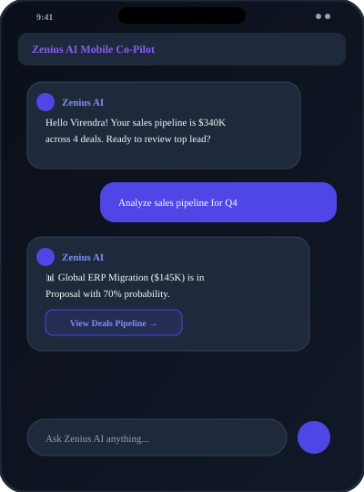
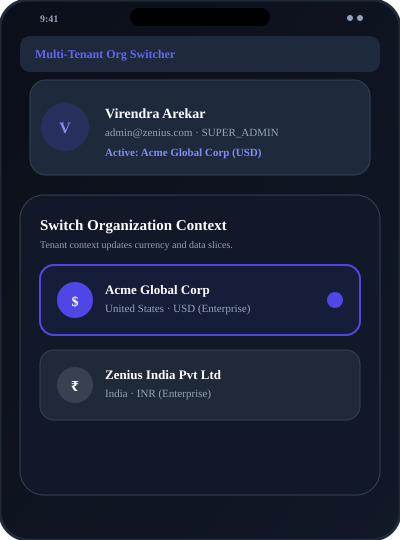

# 📱 Zenius One Mobile App (Flutter)

<p align="center">
  
  <br>
  <strong>Unified Enterprise Mobile Application — CRM, ERP, Geo Attendance & AI Operations</strong>
  <br>
  <em>Designed with Google Flutter & Material 3 · Inspired by Zoho CRM & Zoho One</em>
</p>

---

## 🌟 Overview

The **Zenius One Mobile App** is a cross-platform (iOS, Android, Web, macOS) enterprise mobile client designed to give field sales reps, managers, and executives instant control over CRM pipelines, real-time revenue analytics, field GPS check-in/attendance, and AI-assisted workflows.

### 🎨 App Icon Design
The app icon represents the modern, multi-suite identity of Zenius One:
* **Background:** Multi-stop radial gradient transitioning from Deep Indigo (`#312E81`) to Electric Royal Iris (`#4F46E5`), Violet (`#7C3AED`), and Electric Cyan (`#06B6D4`).
* **Emblem:** High-DPI 3D geometric **'Z'** monogram layered with warm golden amber (`#F59E0B`) ribbon highlights and neon cyan accents.
* **Standard & Professional:** Crafted in SVG vector format and adaptive launcher icons.

---

## 📸 Screen Gallery & Features

<div align="center">

### 1. Executive Command Center (Dashboard)


* **Live Telemetry KPIs:** Real-time Sales Pipeline, Invoiced Revenue, Active Workforce, and Open SLA tickets.
* **Colorful Data Visualizations (`fl_chart`):** Interactive **Bars / Donut** switcher displaying record density and portfolio share across suites.
* **Today's Agenda & Feed:** Quick morning overview of customer meetings, scheduled demos, and hot leads.

---

### 2. Smart Leads & Scoring


* **Automated Lead Scoring:** 0-100 visual score avatar with high-converting color codes (Emerald `>=80`, Amber `>=50`, Red `<50`).
* **Lead Conversion Workflow:** One-tap conversion of qualified leads into Accounts, Contacts, and Pipeline Deals.
* **Instant Actions:** One-tap phone call and email triggers directly from the card.

---

### 3. Deals Pipeline Funnel


* **Probability-Adjusted Weighted Forecast:** Automatic probability calculations for deals across stages.
* **Visual Stage Chips:** Color-coded stages (Prospect, Qualification, Needs Analysis, Proposal, Negotiation, Closed Won, Closed Lost).
* **Progress Steppers:** Visual probability progress bar on every deal card.

---

### 4. Field Sales Geo Check-In & Attendance


* **GPS Geofence Verification:** Automatically detects latitude, longitude, and geocoded address (`San Francisco HQ, 500 Howard St, CA`).
* **Anti-Spoof Guard:** Detects and flags mock locations or VPN location tampering.
* **Leave Management:** Real-time balances for Paid (14d), Casual (8d), and Sick Leave (5d) with application modal.

---

### 5. Zenius AI Mobile Co-Pilot


* **Conversational Executive Intelligence:** Natural language inquiries into sales pipelines, attendance rates, and customer accounts.
* **Action Proposals:** Smart contextual buttons that allow instant navigation (e.g., *"View Deals Pipeline"*, *"Check In Now"*, *"Call Samantha"*).

---

### 6. Multi-Tenant Organization Switcher


* **Zero-Downtime Tenant Switching:** Switch between **Acme Global Corp (USD $)** and **Zenius India Pvt Ltd (INR ₹)**.
* **Dynamic Currency & Cache Refresh:** Instant UI refresh across all pricing, pipelines, and invoice currencies.

</div>

---

## 🚀 How to Run the Application

### 📋 Prerequisites
1. **Flutter SDK:** Flutter 3.16.0 or higher (`flutter --version`)
2. **Dart SDK:** Dart 3.2.0 or higher
3. Target device environment:
   * **Android:** Android Studio / Android SDK with an emulator or connected device.
   * **iOS:** Xcode with iOS Simulator (on macOS).
   * **Chrome:** For instant web preview.

---

### 🛠 Step-by-Step Execution

#### Step 1: Clone the Repository
```bash
git clone https://github.com/VirendraArekar/zenius-app.git
cd zenius-app
```

#### Step 2: Install Flutter Dependencies
```bash
flutter pub get
```

#### Step 3: Configure Backend API Gateway
By default, the app is pre-configured to connect to the Spring Cloud API Gateway:
* **iOS Simulator / Chrome / macOS Desktop:** `http://localhost:8080/api/v1`
* **Android Emulator:** `http://10.0.2.2:8080/api/v1`
* **Physical Device over Wi-Fi:** `http://<your-machine-ip>:8080/api/v1`

> 💡 **Offline / Fallback Resilience:** If the backend services are not running, the application automatically loads high-fidelity demo data so you can test all features, charts, GPS check-ins, and AI interactions immediately without setup!

To change the endpoint, open `lib/core/network/api_client.dart` and update `baseUrl`:
```dart
class ApiClient {
  ApiClient({
    this.baseUrl = 'http://localhost:8080/api/v1',
  });
  ...
}
```

#### Step 4: Run the App on Your Preferred Platform

##### 🌐 Run on Google Chrome (Fastest Preview)
```bash
flutter run -d chrome
```

##### 🤖 Run on Android Emulator
```bash
flutter run -d android
```

##### 🍏 Run on iOS Simulator (macOS)
```bash
flutter run -d ios
```

##### 💻 Run as Native macOS Desktop App
```bash
flutter run -d macos
```

---

## 🏗 Architecture & Code Structure

The project implements the **Clean Layered MVVM Architecture** recommended for scalable Flutter applications:

```text
flutter-app/
├── assets/
│   └── icon/                  # High-res vector & binary app icons
├── screenshots/               # Visual screen mockups & diagrams
├── lib/
│   ├── main.dart              # MultiProvider setup & Material 3 theme entrypoint
│   ├── core/
│   │   ├── constants/         # AppColors, AppTypography, dealStageColors
│   │   ├── network/           # ApiClient with automatic token & tenant headers
│   │   └── theme/             # Light & Dark Material 3 Theme configurations
│   ├── data/
│   │   ├── models/            # Lead, Deal, Attendance, Pulse, Org, AI models
│   │   └── repositories/      # Repositories with caching and API fallback
│   ├── providers/             # ChangeNotifier MVVM ViewModels
│   │   ├── auth_provider.dart
│   │   ├── crm_provider.dart
│   │   ├── dashboard_provider.dart
│   │   ├── attendance_provider.dart
│   │   ├── activity_provider.dart
│   │   └── ai_chat_provider.dart
│   └── ui/
│       ├── common/            # MetricCard, ColorfulChartSection, StatusBadge
│       ├── dialogs/           # CreateLead, CreateDeal, ApplyLeave, OrgSwitcher
│       └── screens/           # Dashboard, Leads, Pipeline, Checkin, AI, More
└── pubspec.yaml               # Flutter dependencies (fl_chart, google_fonts, etc.)
```

---

## 📦 Key Libraries & Technologies

| Library | Version | Purpose |
| :--- | :--- | :--- |
| **Material 3** | Built-in | Modern enterprise component design, light/dark mode |
| **`fl_chart`** | `^0.69.0` | Vibrant multi-color Bar charts, Line charts, Donut charts |
| **`google_fonts`**| `^6.2.1` | Inter & Plus Jakarta Sans typography |
| **`provider`** | `^6.1.2` | Clean reactive MVVM state management |
| **`http`** | `^1.2.2` | REST communication with Spring Cloud Gateway (`:8080`) |
| **`intl`** | `^0.19.0` | Number, date, and multi-currency formatting (`$` / `₹`) |
| **`flutter_animate`** | `^4.5.0` | Fluid micro-interactions and transitions |

---

## ⚖️ Zoho CRM Feature Parity

| Feature | Zoho CRM Mobile | Zenius One Flutter App |
| :--- | :---: | :---: |
| **Executive Daily Feeds** | ✅ | ✅ |
| **Pipeline Stage Funnel** | ✅ | ✅ |
| **Probability Weighted Forecast** | ✅ | ✅ |
| **Lead Scoring (0-100)** | ✅ | ✅ |
| **Lead Conversion to Deal** | ✅ | ✅ |
| **Field GPS Check-In / Check-Out** | ✅ | ✅ |
| **Anti-Spoof Location Guard** | ✅ | ✅ |
| **Leave Request & Balances** | In Zoho People | ✅ Unified |
| **AI Smart Assistant** | Zia | Zenius AI |
| **Multi-Tenant Org Switcher** | ✅ | ✅ |
| **Dark Mode Theme** | ✅ | ✅ |
