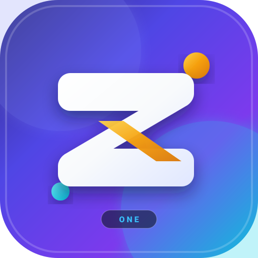
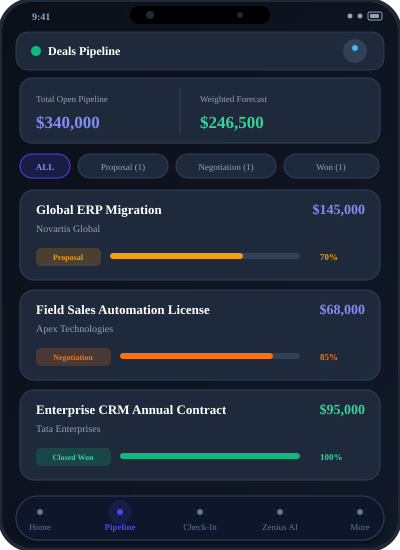
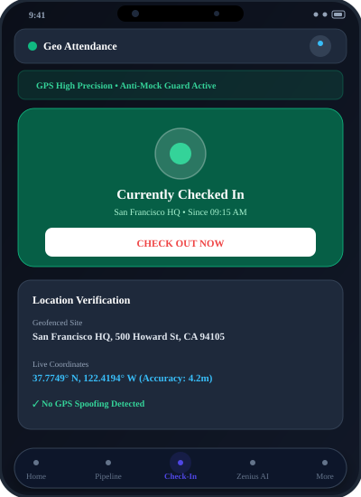
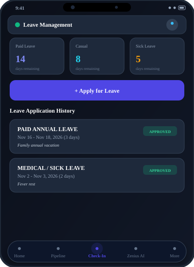
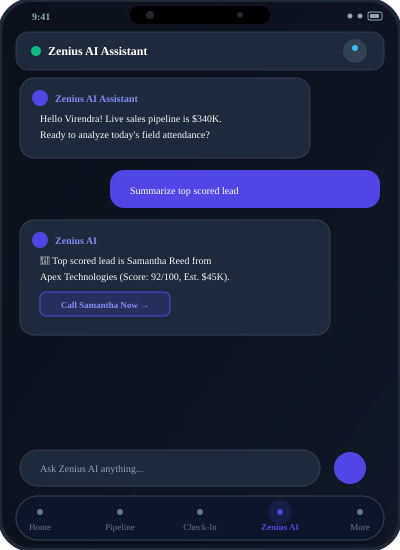
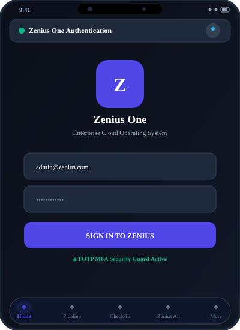

# 📱 Zenius One Mobile App (Flutter)

<p align="center">
  
  <br>
  <strong>Unified Enterprise Mobile Application — CRM, ERP, Geo Attendance & AI Operations</strong>
  <br>
  <em>Built with Google Flutter & Material 3 · Inspired by Zoho CRM & Zoho One</em>
</p>

---

## 🌟 Overview

The **Zenius One Mobile App** is a production-grade, cross-platform mobile client (iOS, Android, Web, macOS) built with Flutter. It provides field sales representatives, operations executives, and managers with real-time sales pipelines, revenue telemetry, field GPS check-in/out attendance, leave applications, activity scheduling, and conversational AI assistance.

### 🎨 App Icon Design
* **Base:** Multi-stage radial gradient squircle (Deep Indigo `#312E81` $\rightarrow$ Royal Iris `#4F46E5` $\rightarrow$ Violet `#7C3AED` $\rightarrow$ Electric Cyan `#06B6D4`).
* **Monogram:** 3D geometric **'Z'** monogram with warm golden amber (`#F59E0B`) ribbon highlights and radiant white bevels.
* **Badging:** Precision-crafted "ONE" pill tag representing all-in-one suite integration.

---

## 📸 Complete Screen Gallery

Every major screen and menu workflow is showcased below:

<div align="center">

### 1. 🏠 Home Screen & Command Center Shell


* **Executive Pulse Banner:** Operational status indicator and current organization tag.
* **4 Telemetry KPI Cards:** Sales Pipeline (\$340K), Invoiced Revenue (\$168K), Active Workforce (32 staff), and Support SLAs (2 open).
* **Real-Time fl_chart Visualizations:** Interactive Bar and Donut chart switcher.
* **Persistent Bottom Navigation:** Direct access to `Home`, `Pipeline`, `Check-In`, `Zenius AI`, and `More`.

---

### 2. 👥 Leads Management & Scoring Menu


* **Automated Scoring (0-100):** Visual score badge with color tiers (Emerald $\ge 80$, Amber $\ge 50$, Red $<50$).
* **Real-Time Filtering & Search:** Instant search by contact name, company, or lead source.
* **One-Tap Actions:** Direct phone dialing, email drafting, and conversion to active deals.

---

### 3. 💼 Deals Pipeline & Stage Funnel Menu


* **Pipeline Summary Header:** Open Pipeline (\$340,000) and Probability-Adjusted Weighted Forecast (\$246,500).
* **Horizontal Stage Chips:** Filter by stages (`Qualification`, `Proposal`, `Negotiation`, `Closed Won`).
* **Deal Cards:** Visual probability progress bars, account names, and deal amounts.

---

### 4. 📍 GPS Field Sales Check-In Menu


* **GPS Geofence Verification:** Automatically logs latitude, longitude, and geocoded site address.
* **Mock Location Prevention:** Built-in anti-spoof guard flags simulated or fake GPS locations.
* **Active Status Card:** Large **CHECK IN** / **CHECK OUT** toggle button with live session duration.

---

### 5. 🏖 Leave Management & Balances Menu


* **Leave Balance Overview:** Paid Annual Leave (14d remaining), Casual Leave (8d), and Sick Leave (5d).
* **One-Tap Application:** Modal to request leaves with category selection, date ranges, and reasons.
* **Application History:** Status pills tracking approved and pending requests.

---

### 6. 📅 Activities & Meetings Agenda Menu


* **Unified Agenda Feed:** Chronological schedule of customer meetings, phone calls, and tasks.
* **Completion Toggles:** Instant checkbox to mark to-dos and follow-ups as finished.
* **Quick Scheduling Modal:** Add new client appointments with date-time pickers.

---

### 7. 🤖 Zenius AI Mobile Co-Pilot Menu


* **Natural Language Queries:** Ask *"Analyze sales pipeline"*, *"Check team attendance"*, or *"Summarize top lead"*.
* **Interactive Action Proposals:** Smart contextual buttons to navigate immediately (*"View Deals Pipeline →"*, *"Call Samantha Now →"*).

---

### 8. ⚙️ More Menu & Profile Settings


* **User Profile Header:** Active user, role badge (`SUPER_ADMIN`), and email.
* **Active Organization Banner:** Tap to open the organization switcher.
* **Dark / Light Theme Toggle:** Instant switch between dark canvas and high-contrast light theme.

---

### 9. 🏢 Multi-Tenant Organization Switcher Sheet


* **Zero-Downtime Tenant Switching:** Switch between **Acme Global Corp (USD $)** and **Zenius India Pvt Ltd (INR ₹)**.
* **Dynamic Currency & Cache Refresh:** Instant updates across all pricing, pipelines, and invoice currencies.

---

### 10. 🔐 Authentication & TOTP MFA Screen


* **Enterprise Security:** JWT-based access with TOTP Multi-Factor Authentication (MFA).
* **Seed Fallback Mode:** Seamless offline evaluation with pre-seeded demo accounts.

</div>

---

## 🚀 Step-by-Step Guide to Run the Application

### 📋 Prerequisites
1. **Flutter SDK:** Flutter 3.16.0 or higher (`flutter --version`)
2. **Dart SDK:** Dart 3.2.0 or higher
3. Target device or emulator:
   * **Web:** Google Chrome (recommended for immediate zero-config testing)
   * **Android:** Android Studio with an Android 12+ Emulator
   * **iOS:** Xcode with iOS Simulator (on macOS)
   * **Desktop:** macOS Desktop support enabled

---

### 🛠 Step-by-Step Commands

#### Step 1: Clone the Repository
```bash
git clone https://github.com/VirendraArekar/zenius-app.git
cd zenius-app
```

#### Step 2: Install Flutter Dependencies
```bash
flutter pub get
```

#### Step 3: Configure Backend API Gateway
By default, the app is pre-configured to connect to the Spring Cloud API Gateway:
* **iOS Simulator / Chrome / macOS Desktop:** `http://localhost:8080/api/v1`
* **Android Emulator:** `http://10.0.2.2:8080/api/v1`
* **Physical Device over Wi-Fi:** `http://<your-machine-ip>:8080/api/v1`

> 💡 **Offline / Fallback Resilience:** If the backend microservices are not running, the application automatically loads high-fidelity demo data so you can test all features, charts, GPS check-ins, and AI interactions immediately without setup!

To change the endpoint, open `lib/core/network/api_client.dart` and update `baseUrl`:
```dart
class ApiClient {
  ApiClient({
    this.baseUrl = 'http://localhost:8080/api/v1',
  });
  ...
}
```

#### Step 4: Run the App on Your Preferred Platform

##### 🌐 Run on Google Chrome (Fastest Preview)
```bash
flutter run -d chrome
```

##### 🤖 Run on Android Emulator
```bash
flutter run -d android
```

##### 🍏 Run on iOS Simulator (macOS)
```bash
flutter run -d ios
```

##### 💻 Run as Native macOS Desktop App
```bash
flutter run -d macos
```

---

## 🏗 Architecture & Code Structure

The project implements the **Clean Layered MVVM Architecture** recommended for scalable Flutter applications:

```text
flutter-app/
├── assets/
│   └── icon/                  # High-res vector & binary app icons (SVG / PNG)
├── screenshots/               # Visual screen mockups & diagrams
├── lib/
│   ├── main.dart              # MultiProvider setup & Material 3 theme entrypoint
│   ├── core/
│   │   ├── constants/         # AppColors, AppTypography, dealStageColors
│   │   ├── network/           # ApiClient with automatic token & tenant headers
│   │   └── theme/             # Light & Dark Material 3 Theme configurations
│   ├── data/
│   │   ├── models/            # Lead, Deal, Attendance, Pulse, Org, AI models
│   │   └── repositories/      # Repositories with caching and API fallback
│   ├── providers/             # ChangeNotifier MVVM ViewModels
│   │   ├── auth_provider.dart
│   │   ├── crm_provider.dart
│   │   ├── dashboard_provider.dart
│   │   ├── attendance_provider.dart
│   │   ├── activity_provider.dart
│   │   └── ai_chat_provider.dart
│   └── ui/
│       ├── common/            # MetricCard, ColorfulChartSection, StatusBadge
│       ├── dialogs/           # CreateLead, CreateDeal, ApplyLeave, OrgSwitcher
│       └── screens/           # Dashboard, Leads, Pipeline, Checkin, AI, More
└── pubspec.yaml               # Flutter dependencies (fl_chart, google_fonts, etc.)
```

---

## 📦 Key Libraries & Technologies

| Library | Version | Purpose |
| :--- | :--- | :--- |
| **Material 3** | Built-in | Modern enterprise component design, light/dark mode |
| **`fl_chart`** | `^0.69.0` | Vibrant multi-color Bar charts, Line charts, Donut charts |
| **`google_fonts`**| `^6.2.1` | Inter & Plus Jakarta Sans typography |
| **`provider`** | `^6.1.2` | Clean reactive MVVM state management |
| **`http`** | `^1.2.2` | REST communication with Spring Cloud Gateway (`:8080`) |
| **`intl`** | `^0.19.0` | Number, date, and multi-currency formatting (`$` / `₹`) |
| **`flutter_animate`** | `^4.5.0` | Fluid micro-interactions and transitions |

---

## ⚖️ Zoho CRM Feature Parity Matrix

| Feature | Zoho CRM Mobile | Zenius One Flutter App |
| :--- | :---: | :---: |
| **Executive Daily Feeds** | ✅ | ✅ |
| **Pipeline Stage Funnel** | ✅ | ✅ |
| **Probability Weighted Forecast** | ✅ | ✅ |
| **Lead Scoring (0-100)** | ✅ | ✅ |
| **Lead Conversion to Deal** | ✅ | ✅ |
| **Field GPS Check-In / Check-Out** | ✅ | ✅ |
| **Anti-Spoof Location Guard** | ✅ | ✅ |
| **Leave Request & Balances** | In Zoho People | ✅ Unified |
| **AI Smart Assistant** | Zia | Zenius AI |
| **Multi-Tenant Org Switcher** | ✅ | ✅ |
| **Dark Mode Theme** | ✅ | ✅ |
